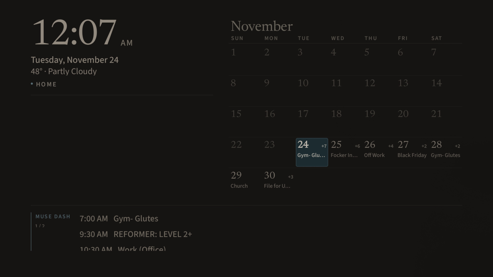

# Muse Ambient

Open-source replacement for Samsung Ambient Mode (Samsung terminated the
Ambient Service after August 1, 2026) for a Samsung QN65Q80R. It does not run
on the Samsung (Tizen) at all: it runs on the Nvidia Shield TV that drives
that TV over HDMI-CEC, as an Android TV system screensaver (DreamService).

Version 0.4.3 (versionCode 14), package `com.jonathancruzate.museambient`,
minSdk 26, target/compile SDK 30 (the Shield's Android 11; raise when a newer
platform jar is installed on the build host). v0.4.3 is installed on the
Shield as the system screensaver. It has two faces, switchable in
Settings: the **Dashboard** (default, new in v0.3) and the **Art slideshow**
(the v0.2.2 system, unchanged), plus a Rotate mode that alternates them.

## Screenshots



*Muse Ambient running as the Shield TV's system screensaver (DreamService): clock and weather, the month wall calendar, and the Muse Dash register. Captured live from the Shield TV on 2026-11-24.*

## Dash items on the wall (v0.4.2)

The footer register under the calendar gains a third voice: the Muse
Dash's own items as readable text (the feed's `dash` field, compiled by
the Muse Dash refresh; see MUSE-FEED.md). Today's events first, then
the Dash's top open items, up to six Newsreader italic lines under an
accent rule with a MUSE DASH attribution. The register stays
single-voice: Now Playing preempts, and the Muse note and the Dash
lines rotate every 45 s when both are present. At night the Dash lines
whisper in the parchment tier instead of being suppressed (Jonathan's
decision), so the wall is never item-less.

## Wall calendar (v0.4.0)

The dashboard's right side is now a proper month wall calendar (Jonathan's
request; design: the Gemini calendar consult,
`~/workspace/shield/gemini-calendar-consult.md`). A printed month broadside:
Newsreader Light month title, tracked Source Sans weekday headers over one
hairline, Newsreader day numerals with no cell gridlines, today in the
slate-teal accent over a short accent rule, event days marked with up to
three small accent dots (never tiny titles, never per-event colours).
Adjacent-month padding cells are bare plaster. The month comes from the
device clock; events come from the feed's `calendar` field, which is
compiled by the Muse Dash refresh pipeline (see MUSE-FEED.md), and a
missing or stale field degrades to a plain grid. The Muse note and Now
Playing share a single-voice footer register under the calendar and never
show at once. At night the calendar whispers in parchment tiers; in house
Night mode it leaves entirely. The night backdrop deepened in this release
(#100E0D) so the panel's local dimming pulls down further.

## Dashboard mode (v0.3.0)

The room already has a real painting, so the TV's default face is not a
second artwork. It is a calm home dashboard printed, editorially, on a
static quiet plaster backdrop (`assets/dashboard-bg.jpg`, a warm greige
wall texture with a measured 216 to 239 luminance range, chosen so the
painting across the room stays the room's one artwork; see
`dashboard-bg/BG-NOTES.md`). The backdrop never moves and never rotates.
The design follows a fresh Gemini consultation (full spec in
`~/workspace/shield/gemini-dashboard-redesign-consult.md`):

- **Typography**: Newsreader (serif) + Source Sans 3, both SIL OFL,
  bundled as static optical-size instances (licenses in
  `assets/fonts/OFL.txt`). No cursive on this face. Nothing is set below
  44 px on the 2160p panel (sp = panel px / 4 at the Shield's density).
- **Layout**: a permanent left spine (clock, date, weather, house mode
  with a single 10 px dot) over a 2 px hairline datum; below it a
  household ledger in three pinned slots (HOME / DAISY / NEXT) that
  dissolve without reflow when empty. Since v0.4.0 the right side
  carries the wall calendar (above).
- **Conditional zones**: the Muse note as Newsreader italic marginalia
  with a slate-teal rule; Now Playing (text only, no album art). Since
  v0.4.0 both live in the footer register under the calendar and
  alternate; since v0.4.2 the Muse Dash items join them there as a
  third rotating voice (above). The Daily Brief remains a rotation
  moment (45 s every 5 min, active hours only, yields for 60 s when
  Daisy or Next changes).
- **Notifications**: top-right, one at a time, on a translucent
  warm-paper veil with a slate-teal bar: 500 ms in, 12 s hold (18 s for
  doorbell), 1500 ms out, queued with per-source cooldown.
- **Color**: one ink `#2B2724` in opacity tiers, one accent slate-teal
  `#2F4F5B`. No shadows, no scrims, no cards. A warm dusk ramp follows
  Astoria sunset, and at Night mode (or 23:00 to 06:30) the face inverts
  to a nocturnal charcoal plaster with dim parchment ink and most zones
  suppressed.
- Content is the same polled Muse feed as the cards (see
  [MUSE-FEED.md](MUSE-FEED.md)); in sample mode it renders the bundled
  sample payload.

## What it does

- Art slideshow **curated to the panel**: only artworks that fit the TV's
  aspect ratio. The Q80R is 16:9 (1.778); the bundled playlist holds only
  pieces within plus/minus 5 percent of that (ratio 1.69 to 1.87), each
  verified against the Wikimedia Commons API (real pixel dimensions, see
  the table in `BuiltInFeed.java`). The loader enforces the same rule on
  ANY feed at decode time: a mismatched piece is skipped silently, never
  shown. In-tolerance art fills the 16:9 frame exactly (center-crop of at
  most a few percent). A configurable JSON playlist URL (array of
  `{title, artist, year, collection, imageUrl}`) is still supported.
  ~60s per slide (configurable), crossfade only.
- **The art is perfectly still.** There is no Ken Burns / pan / zoom of any
  kind (removed in v0.2.2 at the owner's direction); a painting hangs like a
  painting. The only motion is the crossfade between slides and the fades
  of the overlay elements.
- **High resolution**: images are requested from Wikimedia Commons
  Special:FilePath at width 3840 (stepping down to 2560/1920 per item if a
  fetch fails) and decoded at up to the panel's full 3840 width. The image
  cache is versioned (`images-v2`) so no small v0.1.0-era files are reused.
- **Matte painting finish**, tuned for the bright glossy QLED panel: each
  artwork bitmap gets a ColorMatrix chain (saturation x0.85, contrast
  x0.90, blacks lifted slightly) plus a subtle generated paper grain
  (~6 percent alpha, overlay blend) and a gentle vignette (edges darkened
  ~12 percent) drawn over the art. It reads like a matte print under
  museum glass, not a bright TV picture. The artwork itself is never
  blurred; only the transitional crossfade backdrop is.
- Night dimming 23:00-07:00 (~40% brightness overlay).
- Offline resilience: feed and images are disk-cached; failures are silent
  and the bundled list keeps cycling.
- D-pad left/right skips in the preview; in the dream, any key wakes
  (standard Dream behavior).

## Overlay design, Art mode (v0.2.2, "one hand, one ink")

All overlay text follows one system, designed with a Gemini consultation
(full record in BUILD-REPORT.md):

- **One typeface**: Caveat (bundled, SIL Open Font License 1.1, see
  `app/src/main/assets/fonts/OFL.txt`), an open, low-contrast cursive with
  a high x-height. Stock Android "cursive" is the fallback if the asset
  fails to load. No text is smaller than 32px on the 2160p panel (the
  Shield renders its UI at 1920x1080, density 320, so panel px / 4 = sp;
  the floor is 8sp and the smallest text in the app, the label's
  collection line, sits exactly at it).
- **One ink per slide**: a single tone is sampled from the current
  painting and applied identically to every text element on that slide.
  The painting is downscaled; hue comes from the largest mid-chroma
  cluster of the whole-painting palette (warm gallery hue ~75 degrees as
  the monochrome fallback); polarity and lightness are scored against the
  occupied corners' luminance tails with a worst-corner rule and a
  light-ink tie-break. Light ink is clamped to a warm off-white range
  (never pure white), dark ink to a deep range (never pure black);
  effective contrast targets 4.5:1 to 7.5:1. A polarity-aware soft shadow
  (the painting's deepest tone under light ink, a soft highlight cushion
  under dark ink) is the only outline treatment.
- **Conditional scrim**: a radial vignette tinted from the painting may
  fade in at a corner only when that corner's local contrast falls below
  4.5:1, capped at 0.26 (dark) / 0.22 (pale). Default off; never a bar or
  a box.
- **Fixed zones**: clock + date + weather top-left; wall label
  bottom-right (right-aligned); the Muse signed note bottom-left; the
  top-right corner is reserved for live feed alerts and otherwise empty.
  Overlay blocks micro-shift a few pixels per slide against burn-in.

## Muse integration

- **Muse Home card** every Nth slide (default 4th): house mode, who is home,
  Daisy line, next calendar event, now playing, and active alerts, laid out
  as a single ledger (label + value rows) over a blurred wash of the
  preceding painting. No boxes, panels, or borders. A small "Muse"
  wordmark appears on this card only, never on art.
- **Daily Brief card**: a second Muse card variant rendering the brief
  title plus up to 4 brief lines as a centered broadside; Muse slots
  alternate Home / Brief when brief data exists.
- **Muse message as a signed note**: a feed message shows on the Muse card
  and once on the next art slide, as a short line signed "— Muse" in the
  bottom-left corner, in the slide's cursive ink. Silence rule: no message
  in the feed means the corner stays empty. The bundled sample message is
  a clean 9-word line with no metadata parentheticals.
- **Feed alerts, top-right**: when the Muse feed carries alerts, they
  render one at a time in the reserved top-right corner (same cursive,
  same ink, max 2 lines): fade in ~1400 ms, hold ~14 s, fade out
  ~2200 ms, with a 5-minute per-alert re-show cooldown. This is the
  rendering half of live notifications; the feed producer is a separate,
  later job.
- The same feed drives the **Dashboard face** (v0.3): house mode, who is
  home, Daisy, and next event become the pinned ledger; the message
  becomes the italic Muse note; `nowPlaying` becomes the bottom-right
  zone; the brief becomes the rotation moment; alerts use the dashboard's
  own notification treatment (veil + slate bar, described above). The
  cursive alert corner described in the previous bullet is the Art face's
  treatment and is unchanged there.
- Data is **polled**, not served by the app: a configurable Muse feed URL,
  polled every 5 minutes, cached, fail-silent. Schema and producer notes:
  [MUSE-FEED.md](MUSE-FEED.md). Default is empty = sample/demo mode using
  the bundled `assets/home.json`, so the cards render with no live feed.
- Settings toggles for Muse cards and the Muse message overlay (default ON).

## Why hand-built, not AI Studio

AI Studio's Android lane is single-activity Jetpack Compose with no Android
TV / DreamService target. A screensaver needs a manifest-registered
DreamService, Leanback launcher and dream meta-data, so this is a plain
framework Java app (Views, HttpURLConnection, org.json, zero dependencies),
which also builds with no network access.

## Build

```bash
./build.sh   # framework-only, uses ~/workspace/shield-wifi-sense/.toolchain
# output: Muse-Ambient-0.4.3.apk (debug-signed)
```

A standard Gradle project (`settings.gradle`, `app/build.gradle`) is also
included for Android Studio.

## Install on the Shield (do not do this unattended; it changes the TV)

```bash
adb connect <shield-ip>:5555
adb install -r Muse-Ambient-0.4.2.apk
```

Set as screensaver: **Settings > Device Preferences > Screen saver >
Screen saver > Muse Ambient**, or:

```bash
adb shell settings put secure screensaver_components com.jonathancruzate.museambient/.AmbientDreamService
adb shell settings put secure screensaver_activate_on_sleep 1
```

## License

MIT, see LICENSE. The bundled typefaces (Caveat for Art mode; Newsreader
and Source Sans 3 for the Dashboard) are under the SIL Open Font License
1.1 (license texts ship inside the APK at `assets/fonts/OFL.txt`).
Artworks are public domain; see each item's collection credit in the wall
label.
